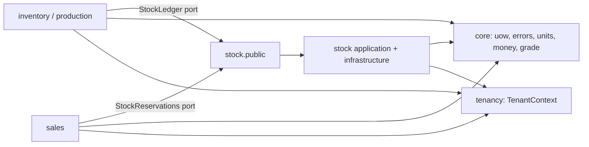

# ADR-001: Modular monolith, hexagonal features, stock public facade

- Status: Accepted
- Implementation status: partly. Implemented: one deployable backend, feature folders with `domain / application /
  infrastructure / presentation`, `Protocol` ports, services that receive repositories by constructor, a single
  SQLAlchemy `Base`, all imports under `apps.backend.src`. Not implemented: the `stock` and `tenancy` modules,
  `features/stock/public.py`, the architecture (import-scan) test, `core` helpers for units/money/grade.

## Context

The backend is a small FastAPI app for a family blueberry business. Features so far: `auth` and `inventory`
(plots, harvests, costs, plants). Stock and sales are coming, and both must change the same numbers atomically
(a harvest creates stock; a sale reserves and deducts it). Several developers (and agents) will work in parallel,
so module boundaries must be enforceable, not just conventional.

## Decision

- One deployable (modular monolith) and one PostgreSQL database.
- Each feature is a hexagon: `presentation -> application -> domain <- infrastructure`. Services depend on
  `Protocol` ports, never on SQLAlchemy; `dependencies.py` wires concrete repositories.
- `features/stock` owns the ledger. Other modules reach it only through `features/stock/public.py` (ports such as
  `StockLedger`, `StockReservations`), which works on the caller's session so the caller's transaction is the
  stock transaction (see ADR-003). `stock` refers to other modules only through opaque ids (`variety_id`, `grade`,
  `SourceRef`), never by importing them.
- Business rules (allocation, units, money, state machine, permissions) are pure functions.
- An import-scan test will fail the build if `sales` or `inventory` import anything from `stock` except `public.py`.

## Alternatives considered

- **Microservices.** Pros: independent deploys and scaling. Cons: stock and sales need one atomic transaction;
  across services that means sagas and outbox, for a team of one family business. Rejected.
- **Plain layered app, no ports (routes call SQLAlchemy).** Pros: least code. Cons: services cannot be tested
  without a database, and rules end up tied to the ORM. Rejected; the existing code and 100+ tests already use ports.
- **Stock tables shared freely (any module updates `stock_lots`).** Pros: no facade code. Cons: the invariant
  `on_hand = sum(ledger)` could be broken from anywhere. Rejected: one writer per invariant.
- **Events between modules (publish/subscribe).** Pros: loose coupling. Cons: eventual consistency where we need
  "reservation succeeded or the sale fails now". Rejected for a single database.

## Consequences

- Cross-module atomicity is free (one session), at the price of the facade being a synchronous in-process API.
- The facade must stay small; if it grows, the stock module is doing too much.
- Splitting a module into a service later is possible because the dependency goes through one interface.
- The rule is only as good as its test: until the architecture test exists, the boundary is by convention.
- The planned rename `inventory` -> `production` is deferred (see [../tech-debt.md](../tech-debt.md)); until then
  `/inventory` means plots, harvests and costs, not stock.
