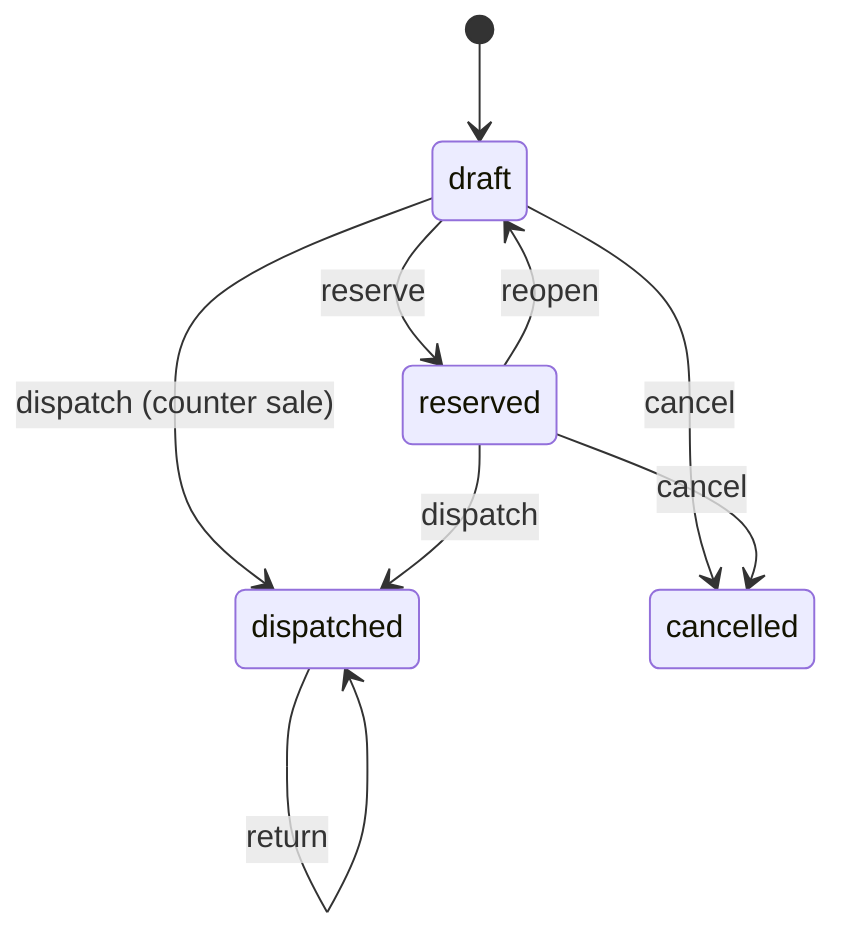

# ADR-010: Sales lifecycle ("cargamento" = dispatched sale), reservations, payments, returns

- Status: Accepted
- Implementation status: not implemented. `features/sales/` exists only as empty files; there are no sales,
  customers or payments tables. Planned in tasks T3.1-T3.8 (revision `0006_sales`).

## Context

The business calls a truckload sold to a buyer a "cargamento". It can mix varieties and grades, be priced per
buyer, be reserved before it leaves, and be paid partially and later. A harvest is a different thing (a stock
entry). See [../GLOSSARY.md](../GLOSSARY.md).

## Decision

- **Dispatch is the cargamento and the only physical deduction** (one `sale_dispatch` movement per line and lot);
  revenue is recognized by `sale_date`. Reserving only raises `reserved_kg` (ADR-007) and freezes lines and total.
- A sale line is one variety + one grade with its own quantity, unit (kg or lb) and unit price; the line total is
  computed from the **entered** unit and price, rounded to the currency scale, so conversion never drifts invoices.
  No discounts.
- Payments (partial allowed) are recorded in `reserved` or `dispatched`; `outstanding = total - returned_total -
  active payments`; `payment_status` and `is_overdue` are derived from the user-set `payment_due_on`. Overpayment is
  409. Cancellation is blocked while active payments exist.
- Returns happen after dispatch, per line; `restock` puts goods back into the line's **own lots** (grade and
  variety preserved), `discard` records the entry and a discard. Refunds of money are outside the system.
- Concurrency: sale row lock plus a `version` on drafts (409 `STALE_VERSION`); human-readable per-organization
  numbers (`V-000123`) from a locked sequence.

## Alternatives considered

- **Deduct stock at order time (no reservation).** Pros: simpler. Cons: cannot hold stock for a buyer without
  committing the sale; counter sales and phone orders behave differently. Rejected.
- **Partial dispatch.** Pros: matches partly shipped orders. Cons: more states and allocation logic. Deferred.
- **Reservation expiry.** Pros: stock does not stay blocked forever. Cons: timers and a job. Deferred; the age of a
  reservation is shown instead.
- **Payments as a field on the sale.** Pros: simpler. Cons: no history, no per-payment void, no partial tracking.
  Rejected.
- **Money as float.** Rejected: see [ADR-011](011-decimal-money-and-units.md).

## Consequences

- Revenue and collected cash are different metrics by construction; reports must name which one they show.
- A return after full payment yields a negative balance, shown as a credit in favor of the buyer.
- The sale module depends on stock only through the public facade (ADR-001).
