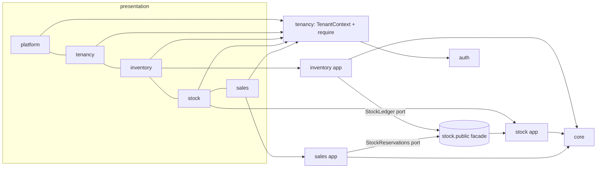
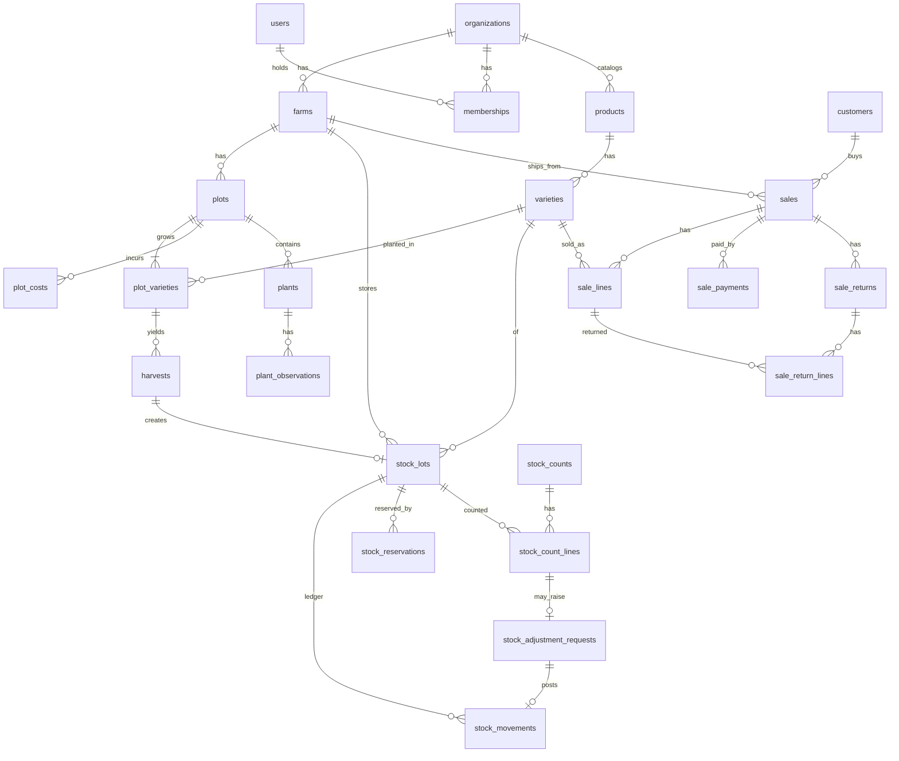
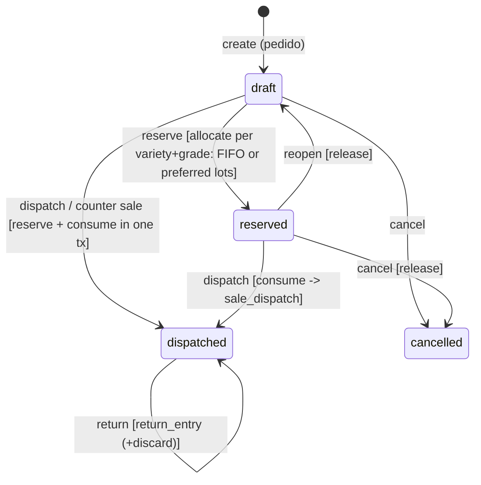

# BerryOps: Technical Plan for Foundations, Inventory (Stock) and Sales (Revision 3)

> Status: PROPOSAL, revised after your answers to Q1–Q19 and O1–O11. Nothing in this document is implemented yet. Suggested path: `docs/plan/foundations-inventory-sales.md`.
> Principles: ub-mode (data shape first, small verifiable increments, TDD, one decision in one place, subtract before adding), Clean Architecture, modular monolith, KISS/YAGNI.

---

## Decisions log

### Round 1 (Q1–Q19)

| Q | Your answer | Design change |
|---|---|---|
| Q1 | A "cargamento" is a truckload **sale/dispatch** to a buyer society, in kg or lb, across several varieties. A harvest is something else: it is a stock entry. | "Cargamento" = a dispatched **Sale**. Variety is a first-class dimension through a `varieties` catalog. Grade became a full dimension later, in O1. |
| Q2 | Yes | New module `features/stock` (UI label "Inventario"). `/inventory` stays as the plots API. |
| Q3 | Only "what is available to sell" matters | No historic harvests are converted to stock. A one-time opening balance is entered per variety and grade. |
| Q4/Q5 | Reservations allowed and visually highlighted; dispatch turns the order into a sale; counter sales allowed | Lifecycle: draft → reserved → dispatched, plus a direct draft → dispatched path. One reserved-stock style is used everywhere. |
| Q6 | FIFO by default, but the user can pick a lot or harvest date by hand | Each sale line can carry an ordered list of preferred lots (strict). Every time FIFO is overridden, an audit event is written. |
| Q7 | Colombia: `America/Bogota`, COP | The org stores `timezone`, `currency_code` and `currency_scale` (0 for COP). Values come from CLI and Alembic `-x` arguments. |
| Q8 | Partial payments, clearly marked, with outstanding balance and the date the buyer promised to pay | `sales.payment_due_on`, set by the user. `payment_status` and `is_overdue` are derived. Refunds stay outside the system. |
| Q9 | Operators must not see financial or sales reports; only members the owner chooses | `memberships.financial_access`, which only the Owner can set. `financials.read` = Owner, or a member with the flag. |
| Q10–Q12 | As planned; no profit figure | Unchanged. |
| Q13 | A global system superuser; under it, org owners who create farms and plots; under them, operators | `users.is_platform_superuser`, set via CLI only. Default access is read-only support access, audited, with RLS unchanged. Owners and Admins manage farms. |
| Q14 | No discounts | No discount fields anywhere. `line_total = round(qty × unit_price)`. |
| Q15 | An existing local dev DB holds real data; local PG is fine for tests; CI comes later | Dev DB protection rules (§10.0). CI is deferred. |
| Q16–Q18 | As planned | Unchanged. The Q17 members UI question is resolved by O4. |
| Q19 | A human-readable id (V-000123) and an explicit buyer, with inline customer creation | `sales.number` per org. The sale form has a customer picker with inline creation. |

### Round 2 (O1–O11)

| O | Your answer | Design change |
|---|---|---|
| O1 | Prices are negotiated per buyer, and they differ by **variety and by grade** | **Grade becomes a first-class stock and sales dimension.** It stays a fixed enum, `premium \| standard \| processing`, as today; a per-org catalog would be YAGNI (ADR-012). A lot's grade is set at harvest and is part of lot identity. Availability, FIFO and manual lot choice are all scoped by farm + variety + grade. Each sale line is one variety + one grade with its own unit price. Reports can group by variety, grade, or both. |
| O2 | A plot can have several varieties | New join table `plot_varieties`. **Each harvest record names exactly one variety**, enforced by a composite FK to `plot_varieties`, plus its grade. If the plot has one variety, the UI picks it automatically. Plants stay without a variety (out of scope). Free-text backfill uses a reviewed mapping CSV for ambiguous values (§10). |
| O6 | Operators can register costs (and harvests, sales…), but only the Owner and flagged members can **view** financial data | Operators get `costs.write`. Every cost read, edit and delete, plus cost totals, `cost_per_kg` and reports, needs `financials.read`. A write response to a caller without that permission is confirmation-only, with no amounts. Money in audit metadata is redacted for the same callers. |
| O8 | Default unit is **pounds**, and each user picks kg or lb | `users.preferred_weight_unit`, default `'lb'`. It is exposed in `/auth/me` and changed with `PATCH /auth/me/preferences`. No org-level default (dropped). Storage stays in kg. Every weight input (harvests included) accepts kg or lb. |
| O3 | (default) | Memberships cover the whole org. Farm scoping is deferred. |
| O4 | (default) | A minimal Members page is included. |
| O5 | (default) | Customers belong to the org. |
| O7 | (default) | One `notes` field. No shipment fields. |
| O9 | (default) | Superuser is read-only, with a break-glass membership when write access is needed. |
| O10 | (default) | The superuser is a separate maintainer account, not the family Owner's account. |
| O11 | (default) | NIT is checked for format only. |

---

## 0. Verification notes (checked in the repo)

- **Confirmed double `Base`.** `apps/backend/src/core/databases/__init__.py:26` loads `"src.core.databases.postgres_db"`, while the models import `apps.backend.src.core.databases.postgres_db`. That gives two `declarative_base()` objects, so `create_all` does nothing. The real dev schema has to be inspected (T0.1).
- **Confirmed.** `auth/dependencies.py:14` uses a dynamic `src.` import, and `except ImportError` hides failures.
- **Confirmed.** `PATCH` and `DELETE /inventory/harvests/{id}` exist; their meaning changes in §3.4.
- **Confirmed.** `plots.variety` is free text (100 characters). `Grade = Literal["premium","standard","processing"]` is used by the summary (`by_grade`), `grade-bars.tsx` and `harvest-sheet.tsx`. `harvests.quantity_kg` is `Numeric(12,2)` in the DB and a float in Pydantic, so it **must be widened to `NUMERIC(14,3)`** to hold lb conversions exactly. The summary already exposes `total_cost` and `cost_per_kg`, which become gated (O6). Plants have no variety.
- **Confirmed.** The frontend never calls `/auth/users` or `/auth/roles`. `ADMIN_ROLES` is hardcoded in `home-page.tsx`.
- **Confirmed.** There is no currency formatting. Springs, glass, tracking and the reduced-transparency/contrast fallbacks already exist and are reused.
- **Unknown until T0.1 (read-only):** PG version (whether `NULLS NOT DISTINCT` is available), the actual schema, distinct `variety` strings and the separators they use, duplicate plot names, and rows that would violate the new CHECKs.

---

## 1. Current state summary

| Area | State | Reuse |
|---|---|---|
| Hexagonal layout, `Protocol` ports | Complete | Same pattern for the new modules |
| Auth (JWT, rotation, hashed refresh tokens) | Complete, single-tenant | Keep; add `/auth/me`, preferences, memberships, superuser flag |
| Plots, plants, harvests, costs, CSV, summary | Complete. Owner-scoped. Variety is free text, one per plot. | Becomes the **production** sub-domain. Harvest is the stock entry source. |
| Global roles / `ADMIN_ROLE_NAMES` | Weak | Replaced |
| Transactions / Decimal / migrations | Missing / partial / missing | Unit of work, Decimal, Alembic |
| `sales/`, `expenses/` scaffolding | Empty | Build `sales/`; delete `expenses/` |
| Frontend shared UI, springs, glass, i18n | Complete | Reuse and extend |
| Tests | 91 backend (fakes + SQLite), 5 frontend | Keep; add a PG suite |
| Docs | Stale, in Spanish; README is corrupted | Rewrite in English area by area |

---

## 2. Proposed architecture

### 2.1 Modules

| Module | Responsibility | Owns |
|---|---|---|
| `core` | config, engine, **UnitOfWork**, error envelope, idempotency, audit writer (with financial redaction), org-local clock, `units` (kg/lb), `money` (currency rounding), `Grade` enum | `idempotency_keys`, `audit_events` |
| `features/tenancy` | organizations, farms, memberships, permission matrix, `TenantContext`, platform access | `organizations`, `farms`, `memberships` |
| `features/auth` | identity, credentials, sessions, **user preferences** | `users`, `user_sessions` |
| `features/inventory` (production) | plots, **plot varieties**, plants, observations, harvests, costs, products/varieties catalog | existing tables + `products`, `varieties`, `plot_varieties` |
| `features/stock` | lots, ledger, reservations, counts, adjustments, availability | `stock_*` |
| `features/sales` | customers, sales, payments, returns, sales reports | `customers`, `sales*`, `document_sequences` |

`Grade` lives in `core` (`core/domain/grade.py`) because production, stock and sales all use it. Keeping it in one place satisfies "one decision lives in one place".

### 2.2 Dependency direction



- `sales` and `inventory` import only `features/stock/public.py`.
- `stock` refers to other modules only through `SourceRef` and the ids `variety_id` and `grade`.
- An architecture test enforces both rules (§13).
- Domain rules are pure functions: allocation, units, money, the state machine, permissions and variety normalization.

### 2.3 Transaction boundary

- Each command runs in one transaction (`get_uow()`). That transaction:
  - begins,
  - sets `set_config('app.org_id'/'app.user_id', …, true)`,
  - sets `SET LOCAL lock_timeout='5s'`,
  - commits on success and rolls back on any exception.
- Repositories flush and never commit.
- The stock facade uses the caller's session, so a harvest plus its lot and movement, or a sale plus its reservations, is atomic. Audit and idempotency rows are written in the same transaction.
- Rejected alternatives:
  - Per-repository commits: allow partial writes.
  - Outbox: unnecessary with a single database.
  - SERIALIZABLE everywhere: needs retry loops.

---

## 3. Data model

**Conventions**
- UUID primary keys.
- Every tenant table has `organization_id NOT NULL` and `UNIQUE(organization_id, id)`.
- Children use **composite FKs** `(organization_id, parent_id)`, which makes cross-tenant references impossible to store.
- Timestamps are `timestamptz`; business dates are `date` (org-local).

**Precision**
- Weight: `NUMERIC(14,3)` in **kg**.
- Entered quantities: `NUMERIC(14,3)` in the entered unit.
- Unit prices: `NUMERIC(14,2)` per entered unit.
- Money: `NUMERIC(16,2)`, rounded `ROUND_HALF_UP` to `currency_scale` (COP = 0).

**Grade** is a fixed enum checked by CHECK constraints: `quality_grade IN ('premium','standard','processing')`.

### 3.1 Tenancy and identity

| Table | Columns | Constraints |
|---|---|---|
| `organizations` | id, name, slug, currency_code char(3), currency_scale smallint, timezone, is_active, created_at | UNIQUE(slug); CHECK currency format; CHECK scale 0..3 |
| `farms` | id, organization_id, name, location null, is_active, created_at | UNIQUE(org,name); UNIQUE(org,id) |
| `memberships` | id, organization_id, user_id, role, **financial_access bool default false**, status, created_at, created_by | UNIQUE(org,user_id); CHECK role IN ('owner','admin','operator','viewer'); CHECK status IN ('active','disabled') |
| `users` (alter) | + **is_platform_superuser bool default false**, + **preferred_weight_unit varchar(2) NOT NULL default 'lb'**; `role_id` becomes nullable (deprecated) | CHECK preferred_weight_unit IN ('kg','lb') |

**Rules enforced in the service (under a membership lock)**
- An org must keep at least one active owner.
- Only an Owner can change `financial_access` or the owner role.
- For owners, the flag is implicitly true.

**Why the preference lives on `users` and not in a `user_preferences` table:** there is a single scalar setting, so a separate table would be speculative (YAGNI). The preference applies across all of the user's orgs, and no org fallback is needed because the column is NOT NULL with default `lb`.

### 3.2 Production (existing tables altered, plus the catalog)

| Table | Columns / changes | Constraints |
|---|---|---|
| `products` (new) | id, organization_id, name, is_active, created_at | UNIQUE(org,name), UNIQUE(org,id). Seeded with "Arándano"; no UI in the MVP |
| `varieties` (new) | id, organization_id, product_id, name, normalized_name, is_active, created_at | FK (org,product_id) → products; UNIQUE(org,normalized_name); UNIQUE(org,id) |
| `plot_varieties` (new) | organization_id, plot_id, variety_id, created_at | **PK(organization_id, plot_id, variety_id)**; FK (org,plot_id) → plots ON DELETE CASCADE; FK (org,variety_id) → varieties |
| `plots` | + organization_id, farm_id (composite FK); `variety` text kept during expand and dropped at contract; UNIQUE(org,id); UNIQUE(farm_id,name) replaces `uq_plots_owner_name`; `owner_id` now only means "created by" | |
| `harvests` | + organization_id; **variety_id NOT NULL**; FK **(org, plot_id, variety_id) → plot_varieties**, which proves the variety belongs to the plot; `quantity_kg` widened to `NUMERIC(14,3)`; + entered_unit, entered_quantity (null for historic rows); recorded_by null; voided_at, voided_by; CHECK quantity_kg>0; CHECK grade enum; UNIQUE(org,id) | |
| `plot_costs`, `plants`, `plant_observations` | + organization_id and a composite FK. Plants stay **without a variety** (O2 scope) | |

- Service rule: a plot must keep at least one variety.
- A variety cannot be removed from a plot while non-voided harvests reference it. The DB blocks this through the FK (RESTRICT). The service returns 409 `VARIETY_IN_USE`.
- Normalization lives in one function, `inventory/domain/varieties.py`, which the migration also uses: `lower(collapse_ws(trim(name)))`. Accents are kept. Near-duplicates are reported, not merged.

### 3.3 Stock

| Table | Columns | Constraints / indexes |
|---|---|---|
| `stock_lots` | id, organization_id, farm_id, variety_id, **quality_grade**, plot_id null, harvest_id null, code (per-org `L-000123`), harvested_on null, received_on, initial_kg, **on_hand_kg**, **reserved_kg**, status, created_at, updated_at | Composite FKs; UNIQUE(org,id), (org,code), (harvest_id) WHERE NOT NULL; CHECK grade enum; CHECK initial>0, on_hand≥0, reserved≥0, **reserved ≤ on_hand**; CHECK status IN ('available','blocked','depleted'); INDEX(org,farm_id,variety_id,quality_grade,status,harvested_on) |
| `stock_movements` (append-only) | id, organization_id, farm_id, lot_id, variety_id, quality_grade, movement_type, **quantity_kg** signed, occurred_on, recorded_at, recorded_by, source_type, source_id, source_line_id null, reverses_movement_id null, reason_code null, notes, entered_unit null, entered_quantity null | Composite FKs; CHECK qty≠0; CHECK sign matches type; CHECK reason required for shrinkage/discard/adjustment/correction; **UNIQUE(org,source_type,source_id,source_line_id,lot_id,movement_type) NULLS NOT DISTINCT** (PG<15: COALESCE unique index); INDEX(org,lot_id,recorded_at), (org,farm_id,occurred_on), (org,source_type,source_id) |
| `stock_reservations` | id, organization_id, farm_id, lot_id, source_type, source_id, source_line_id, quantity_kg, status, created_at, created_by, closed_at | CHECK qty>0; CHECK status IN ('active','consumed','released'); UNIQUE(org,source…,lot_id); partial INDEX(lot_id) WHERE active |
| `stock_counts` | id, organization_id, farm_id, counted_on, status, measurement_source default 'manual', notes, created_by, submitted_at, submitted_by | CHECKs |
| `stock_count_lines` | id, organization_id, count_id, lot_id, counted_kg, entered_unit, entered_quantity, expected_kg null, difference_kg GENERATED STORED, review_status, review_notes, reviewed_by, reviewed_at, external_reference null | UNIQUE(count_id,lot_id); CHECKs |
| `stock_adjustment_requests` | id, organization_id, farm_id, lot_id, delta_kg, reason_code, notes, count_line_id null, status, requested_by, requested_at, decided_by, decided_at, decision_notes, movement_id null | CHECK delta≠0; CHECK (approved) = (movement_id NOT NULL) |

`variety_id` and `quality_grade` on movements are copied from the lot so reports need no join. A CHECK cannot compare them with the lot, so the service writes them from the locked lot row, and a test checks they match.

**Movement types**

| Type | Sign | Source | Who |
|---|---|---|---|
| `harvest_entry` | + | harvest | operator+ |
| `opening_balance` | + | opening | admin+ |
| `sale_dispatch` | − | sale line | operator+ |
| `return_entry` | + | sale_return line | operator+ |
| `shrinkage` | − | manual | operator+ |
| `discard` | − | manual / return | operator+ |
| `adjustment` | ± | approved request | admin+ approves |
| `correction` | ± opposite of the original | original movement | admin+, or system on harvest edit |

`transfer` and `regrade` are deferred (see N1).

**Stock model: ledger plus a projection on the lot row**
- The ledger is the truth. `on_hand_kg` and `reserved_kg` are updated in the same transaction as each movement.
- Invariant: `on_hand_kg = Σ quantity_kg`. A `verify-stock` command and a test check it.
- Why this design: there is one row to lock, CHECKs make negative stock and over-reservation impossible to commit, and reading availability is O(1).

**Other stock rules**
- **Availability** = `on_hand − reserved`, grouped by **farm + variety + grade**.
- **Lot identity** = farm + variety + grade + harvest date (+ plot). A lot never changes variety or grade.
- **Lot status:** `depleted` is set automatically when on-hand reaches 0 and cleared when stock comes back. `blocked` is a manual hold that excludes the lot from allocation.
- **UI label of a lot:** "Biloxi · Premium · 12 nov · Lote Norte · 340 lb disponibles".

### 3.4 How existing data maps

- **One lot per harvest.** A harvest is one record per plot + variety + grade + date. It creates exactly one lot (variety and grade copied) and one `harvest_entry`, in the same transaction.
- **`PATCH harvest`:**
  - Changing quantity posts a `correction` for the delta. If on-hand would fall below reserved or below 0, it fails with 409 `INSUFFICIENT_STOCK`.
  - Changing **plot, variety, grade or date** is allowed only while the lot has no movements other than its entry and no reservations. In that case the harvest and the lot are updated together, which is safe because nothing has used the lot yet. Otherwise it fails with 409 `HARVEST_LOCKED`.
- **`DELETE harvest`** becomes a void. It is allowed only if the lot has only its entry and corrections. It posts a correction down to 0, sets `voided_at`, and marks the lot `depleted`. Voided harvests are excluded from summaries.
- **Historic harvests** get `variety_id` from the backfill (§10). No lots are created for them; stock starts from opening balances per farm + variety + grade.
- **Summary** keeps `by_grade` and adds `by_variety` and `by_variety_grade` (kg, in the requested unit). Cost fields appear only for callers with `financials.read`.

### 3.5 Sales

| Table | Columns | Constraints |
|---|---|---|
| `customers` | id, organization_id, name (razón social), tax_id null (NIT digits + optional DV, format only), contact_name, phone, email, address, notes, is_active, created_at, updated_at | UNIQUE(org,id); UNIQUE(org,tax_id) WHERE NOT NULL; INDEX(org,lower(name)) |
| `document_sequences` | organization_id, kind ('sale','lot'), next_value | PK(org,kind); `FOR UPDATE` on assign |
| `sales` | id, organization_id, farm_id, customer_id, number, sale_date, status, currency_code, total, returned_total default 0, **payment_due_on null**, notes varchar(1000), version, created_by, created_at, reserved_at, dispatched_at, dispatched_by, cancelled_at, cancelled_by, cancel_reason | Composite FKs; UNIQUE(org,number); CHECK status IN ('draft','reserved','dispatched','cancelled'); CHECK 0≤returned_total≤total; indexes on (org,status,sale_date), (org,customer_id,sale_date), partial (org,payment_due_on) WHERE dispatched |
| `sale_lines` | id, organization_id, sale_id, line_no, **variety_id**, **quality_grade**, quantity, unit, quantity_kg, unit_price (per `unit`), line_total, preferred_lot_ids uuid[] null | Composite FKs (sale, variety); UNIQUE(sale_id,line_no); CHECK grade enum, unit IN ('kg','lb'), qty>0, kg>0, price≥0, total≥0 |
| `sale_payments` | id, organization_id, sale_id, paid_on, amount, method, reference, recorded_by, recorded_at, voided_at, voided_by, void_reason | CHECK amount>0; CHECK method IN ('cash','transfer','check','other') |
| `sale_returns` | id, organization_id, sale_id, returned_on, reason, credit_total, created_by, created_at | |
| `sale_return_lines` | id, organization_id, return_id, sale_line_id, quantity (in the line's unit), quantity_kg, disposition, credit_amount | CHECK qty>0; CHECK disposition IN ('restock','discard') |

**Totals (pure functions)**
- `line_total = round_currency(quantity × unit_price)`.
- `total = Σ line_total`.
- Return credit = `round_currency(returned_qty × unit_price)`. The last return of a line takes the remaining money and the remaining kg.
- Several lines may share the same variety + grade (different prices or lots).
- `preferred_lot_ids` holds opaque ids. They are not an FK and are validated by the stock port.

### 3.6 Units (kg canonical, lb default display)

- **Storage:** stock, ledger, harvests, availability and reports are stored in kg, `NUMERIC(14,3)`.
- **Conversion:** 1 lb = **0.45359237 kg** (exact by definition), defined only in `core/units.py`.
  - `kg = round_half_up(lb × 0.45359237, 3)`, so the error is at most 0.5 g.
  - Display in lb = `kg / 0.45359237`, shown with 1 decimal and never stored.
- **Input:** every weight input (harvest, opening balance, shrinkage, discard, count, adjustment, sale line, return) takes `{quantity, unit}`.
  - The server converts once, at the boundary.
  - Harvests and movements also keep `entered_unit` and `entered_quantity`.
  - The legacy harvest field `quantity_kg` is still accepted.
- **Sale lines** store what the buyer agreed: `quantity`, `unit`, `unit_price` per that unit, plus the canonical `quantity_kg`.
  - Money is computed from the entered values, so invoices do not drift through conversion.
  - Stock is computed from kg.
- **Display preference** comes from `users.preferred_weight_unit` (default lb). Every form has a kg/lb toggle that starts on the user's preference.
- **Read endpoints** accept `?unit=kg|lb`. If it is omitted, the server uses the caller's preference (useful for CSV). Responses carry `unit` explicitly.
- **CSV** shows the entered unit and quantity plus `quantity_kg`.
- **Average price** is reported per kg, or per lb when requested: `per_lb = per_kg × 0.45359237`, rounded to currency scale.

### 3.7 Cross-cutting

| Table | Columns | Constraints |
|---|---|---|
| `audit_events` | id, organization_id null, actor_user_id, actor_kind ('member','platform','system'), action, entity_type, entity_id, occurred_at, request_id, metadata jsonb (`{…, "financial": {…}}`) | Indexes (org,occurred_at desc), (org,entity), (actor,occurred_at). Immutable |
| `idempotency_keys` | organization_id, key, user_id, endpoint, request_hash, response_status, response_body jsonb, created_at | PK(org,key) |

### 3.8 ER diagram



Grade is a column on harvests, lots, movements and sale lines, not an entity. Sales link to stock through `source_*` columns, deliberately not FKs.

---

## 4. Multi-tenancy and authorization

### 4.1 Tenant resolution

- The client sends `X-Organization-Id`. It is only a selector; the server trusts membership, not the header.
- For members: the server looks up an active `memberships` row for (token.sub, header). If none exists, it returns 404 `ORGANIZATION_NOT_FOUND`. Platform superusers are handled as described in §4.3.
- If the header is missing and the user has exactly one membership, that org is used. Otherwise 400 `ORGANIZATION_REQUIRED`.
- `farm_id` is validated as belonging to the org (404 otherwise), and composite FKs enforce the same thing in the DB.
- **Why a header and not a token claim:** org switches need no re-issued token, and changes to role or `financial_access` take effect on the next request. The JWT stays identity-only.
- The resulting context is `TenantContext(user_id, organization_id, actor_kind, role|None, permissions)`, built through `require(Permission.X)`.

### 4.2 Permission matrix (static, `tenancy/domain/permissions.py`) plus one flag

| Permission | Owner | Admin | Operator | Viewer | Superuser (support) |
|---|:-:|:-:|:-:|:-:|:-:|
| production.read, stock.read, customers.read, sales.read (individual sales, see N2) | ✓ | ✓ | ✓ | ✓ | ✓ |
| production.write (plots, plot varieties, plants, harvests) | ✓ | ✓ | ✓ | | |
| **costs.write** (create a cost) | ✓ | ✓ | ✓ | | |
| catalog.manage (varieties), farms.manage | ✓ | ✓ | | | |
| stock.record, stock.count, adjustment requests | ✓ | ✓ | ✓ | | |
| stock.approve | ✓ | ✓ | | | |
| customers.write, sales.write (incl. manual lots, due date), sales.cancel, sales.return, payments.record | ✓ | ✓ | ✓ | | |
| payments.void | ✓ | ✓ | | | |
| **financials.read**: list/read/edit/delete costs, cost totals, `cost_per_kg`, sales/receivables reports, money KPIs, customer totals, unredacted audit money | ✓ | flag | flag | flag | ✓ |
| audit.read (money redacted without financials.read) | ✓ | ✓ | | | ✓ |
| members.manage (create users, roles except owner, disable) | ✓ | ✓ | | | |
| members.grant_financial, owner changes, org.manage | ✓ | | | | |
| platform.* | | | | | ✓ |

"flag" = `memberships.financial_access = true`, which only an Owner can set.

**O6 details: no financial data leaks to operators**
- `POST /inventory/plots/{id}/costs` without `financials.read` returns `201 {"id", "status": "recorded"}`: no amount, no totals. With `financials.read`, it returns the full cost.
- `GET` costs, `PATCH`/`DELETE` costs and cost CSV export need `financials.read` → 403. Correcting a mistyped cost is therefore done by a financial user. The UI tells the operator so.
- `/inventory/summary` and plot responses drop `total_cost`, `cost_per_kg`, `by_category` for callers without `financials.read`. These fields are never zeroed: they are **absent**, so absence cannot be read as "0 cost".
- Audit `metadata.financial` is stripped for readers without `financials.read`.
- Operators see the outcome of their own cost entries only as an immediate confirmation ("Gasto registrado"). There is no list of past entries (recommended minimum).

**What an Operator sees:** availability and lots (weights), movements, harvests, plants, customers, and individual sales including prices and balances, because they register them (N2). They do not see reports, money KPIs, costs or customer totals.

### 4.3 Platform superuser

- **Flag:** `users.is_platform_superuser`, set only through CLI `grant-superuser` (DB-owner credentials). No HTTP endpoint grants it, and no email, id or role name is hardcoded.
- **Account:** a separate maintainer account (O10).
- **Access model (O9):** read-only support access to the org explicitly selected with `X-Organization-Id`.
  - Context is `actor_kind='platform'` with read permissions only, including `financials.read` and `audit.read`.
  - Any write returns 403 `READ_ONLY_SUPPORT`.
  - Writes need a break-glass path: the superuser adds an explicit Admin membership to that org. The addition is audited and visible to the Owner, who can remove it.
- **RLS stays intact:** the superuser uses the same `arandanos_app` role (NOBYPASSRLS) and the same `set_config('app.org_id', …, true)`, so it sees one org per transaction.
- **Platform endpoints** (`/platform/organizations`) read only non-RLS tables.
- **Audit:** every superuser request inside an org writes `platform.access` (method + route template), visible to that org's owners. Platform actions are audited too.
- **How this differs from the old hole:** the old one granted privilege from a role name matched against an env var, and that privilege bypassed scoping. The new flag is DB-only, CLI-provisioned, read-only, scoped to one tenant per transaction, and audited.
- **Alternatives:** full admin (any compromise could corrupt every tenant) or impersonation (wrong attribution, complex). Both rejected.
- **Risks:** a stolen superuser token can read all tenants. Mitigations: CLI provisioning, short TTL, audit. MFA and IP allowlisting are deferred.
- **Entitlements** never apply to platform actors.
- **Who creates orgs:** the superuser (`POST /platform/organizations` or CLI). Owners then create farms, plots and members.

### 4.4 PostgreSQL RLS (defense in depth)

- **Roles:**
  - `arandanos_owner`: schema owner, used by Alembic and the CLI.
  - `arandanos_app`: NOSUPERUSER, NOBYPASSRLS, not an owner. No UPDATE/DELETE on ledger or audit tables.
- **Policy:** ENABLE + FORCE RLS on every tenant table, `organization_id = current_setting('app.org_id', true)::uuid`. When the setting is missing the comparison is NULL, so the policy fails closed.
- **Context** is set transaction-locally (`set_config(...,true)`), so it cannot leak across pooled connections.
- **Tables without RLS:** `users`, `user_sessions`, `organizations`.
- **`memberships`** uses `org = app.org_id OR user_id = app.user_id`.
- App-level filtering stays the primary mechanism. T1.8 is isolated so it can slip.

### 4.5 Entitlements (documented only)

A future `organization_entitlements` table would be checked in `require(..., feature=)` for member actors only.
- Permission = what the role or flag allows.
- Entitlement = what the org has purchased or been granted.
- Billing would only write entitlements. The family org would get a permanent row, not a code branch.

---

## 5. Concurrency, idempotency and consistency

**Isolation:** READ COMMITTED plus `SELECT … FOR UPDATE`, with a 5 s `lock_timeout`. On timeout the API returns 503 `RETRY_LATER`. CHECK constraints are the last guard.

**Lock order:** aggregate root first (sale, count, request), then lots **ordered by id**.

**Allocation** is a pure function `allocate(candidate_lots, kg, preferred_lot_ids)`. Candidates are `available` lots of the line's **farm + variety + grade**.
- Default: FIFO by `harvested_on`, then `received_on`, then `code`.
- Manual (Q6): only the listed lots are used, in the given order. Each lot must match farm + variety + grade. If they don't cover the quantity, the API returns 409 `INSUFFICIENT_STOCK_IN_SELECTED_LOTS` with per-lot availability. There is no silent fallback. Exact splits are done with multiple lines.
- If the result differs from FIFO, audit records `fifo_override: true`.
- FEFO is not used because there is no expiry data. Harvest date already approximates freshness.

**Idempotency**
- Command POSTs require an `Idempotency-Key`.
- The key row is inserted in the same transaction with `ON CONFLICT DO NOTHING`.
  - Same key, same hash: replay the stored response.
  - Same key, different hash: 422 `IDEMPOTENCY_KEY_REUSED`.
  - Concurrent duplicate: waits on the unique index, then replays.
  - Rolled-back attempt: leaves no key behind.

**No double deduction:** state guards under the sale row lock, plus the ledger unique key.

**Compensation, never mutation:** errors are fixed with corrections or approved adjustments.

**No partial writes:** one transaction per command. A PG failure-injection test verifies it.

**Scenarios**

| Scenario | Outcome |
|---|---|
| Two sales reserve the last 400 lb of Biloxi Premium | The second gets 409 `INSUFFICIENT_STOCK` |
| Biloxi Standard is available but the line asks for Premium | 409. Availability by grade is shown in `details` |
| A manually picked lot is taken a second earlier by another sale | 409 `…_IN_SELECTED_LOTS`. The UI reloads the lots |
| Double tap on Despachar (same key) | The first response is replayed |
| Two devices dispatch the same sale | Sale lock → 409 `INVALID_STATE_TRANSITION` |
| Entry of 100 lb exactly equals 45.359 kg on hand | Passes (Decimal comparison) |
| Shrinkage and dispatch on the same lot at once | Serialized. Whichever would break `on_hand ≥ reserved` gets 409 |
| Harvest grade edited after a reservation on its lot | 409 `HARVEST_LOCKED` |
| Same draft edited from two devices | 409 `STALE_VERSION` |
| An adjustment approved twice | 409 |

---

## 6. Sales lifecycle ("cargamento")



| Concept | Rule |
|---|---|
| Order | `draft`. Lines (variety, grade, quantity, unit, price, optional lots) can be edited. No effect on stock |
| Reservation | `reserved`. `reserved_kg` goes up and on-hand is unchanged. Lines and total are frozen. Highlighted in the UI |
| Dispatch = cargamento = confirmed sale | **The only physical deduction.** One `sale_dispatch` per (line, lot). Revenue is recognized by `sale_date` |
| Payment | Allowed in reserved or dispatched. `outstanding = total − returned_total − Σ active payments`. Status is unpaid, **partial** or paid. `payment_due_on` is set by the user, editable while outstanding > 0, and audited. `is_overdue` = outstanding > 0 and due date < org-local today |
| Cancellation | From draft or reserved. Releases the reservation. Blocked while active payments exist |
| Return | After dispatch, per line, with cumulative quantity ≤ line quantity. `restock` puts stock back into the line's **own lots**, so grade and variety are preserved (most recent lot first). `discard` records `return_entry` followed by `discard` |

**Payment and dispatch limits**
- Overpayment returns 409.
- If a return happens after full payment, the balance goes negative and is shown as "saldo a favor del comprador".
- Only full dispatch is supported. Reservations have no expiry, but their age is shown.

---

## 7. Reconciliation and audit

```mermaid
sequenceDiagram
  participant Op as Operator
  participant API
  participant Adm as Admin/Owner
  Op->>API: count (draft): counted lb/kg per lot (lots grouped by variety+grade)
  Op->>API: submit
  API->>API: lock lots, expected snapshot, difference; diff != 0 -> pending
  Note over API: "Diferencia pendiente de revisión"
  Adm->>API: explain OR adjustment request
  Adm->>API: approve -> lock lot, adjustment movement
```

**Reconciliation rules**
- Counts are per lot, so variety and grade are implicit.
- Differences are stored and applied as deltas.
- An adjustment that would push on-hand below reserved is rejected.
- Self-approval is allowed and flagged.
- Future scale hooks are limited to `measurement_source` and `external_reference`.

**Audit**
- Events are written by `core/audit` in the same transaction. They cover:
  - stock movements, adjustments, counts, lot blocks, and harvest corrections and voids;
  - plot variety changes and cost recorded/edited/deleted (with the amount under `financial`);
  - sale created, reserved (`fifo_override`), reopened, dispatched, cancelled, due-date changed;
  - payments recorded or voided, returns;
  - membership changes, including `financial_access`;
  - preference changes (not audited; non-critical);
  - `platform.access` and platform actions;
  - failed logins (username hashed).
- Metadata is whitelisted: no names, NIT, phones, emails or tokens.
- Events are immutable: a trigger blocks changes and the app role has no UPDATE or DELETE grant.

---

## 8. API contract

### Common conventions

- **Headers:** `Authorization: Bearer`, `X-Organization-Id`, and `Idempotency-Key` on endpoints marked (I).
- **Decimals** are JSON strings in new endpoints.
- **Weights:** input is `{quantity, unit}`; output is weight strings plus an explicit `unit`, with `?unit=` defaulting to the user's preference.
- **Errors:** `{"detail", "code", "details"}`. `IntegrityError` maps to 409 or 422.

| Status | Codes |
|---|---|
| 401 | (unauthenticated) |
| 403 | `FORBIDDEN`, `READ_ONLY_SUPPORT` |
| 404 | not found, **including cross-tenant** |
| 409 | `INSUFFICIENT_STOCK`, `INSUFFICIENT_STOCK_IN_SELECTED_LOTS`, `INVALID_STATE_TRANSITION`, `STALE_VERSION`, `HARVEST_LOCKED`, `VARIETY_IN_USE`, `PAYMENT_EXCEEDS_BALANCE`, `HAS_ACTIVE_PAYMENTS`, `CONFLICT` |
| 422 | validation, `IDEMPOTENCY_KEY_REUSED`, `VARIETY_NOT_IN_PLOT`, `UNKNOWN_VARIETY` |
| 503 | `RETRY_LATER` |

- **Pagination:** `?limit&cursor` → `{items, next_cursor}`.

### Auth, tenancy and platform

- `GET /auth/me` → `{user:{…, preferred_weight_unit}, is_platform_superuser, memberships:[{organization:{id,name,currency_code,currency_scale,timezone}, role, financial_access, permissions, farms}]}`.
- `PATCH /auth/me/preferences {preferred_weight_unit: "kg"|"lb"}`.
- Login, refresh and logout are unchanged.
- `GET /auth/users/{username}` returns the caller only.
- Removed: `POST /auth/roles`, `POST /auth/users`, and the bootstrap endpoint.
- `GET/POST /farms`, `PATCH /farms/{id}`.
- `GET /members`, `POST /members`, `PATCH /members/{id} {role?, status?, financial_access?}`.
- `GET/POST /platform/organizations` (POST also creates the farm and the first Owner), `PATCH /platform/organizations/{id}`.

### Production (`/inventory`, backward compatible)

- All routes are org-scoped. The `owner` query parameter is ignored and later removed.
- **Plots**
  - Accept `variety_ids: [uuid]` (at least 1), or the legacy `variety` text, which resolves to exactly one catalog variety or fails with 422 `UNKNOWN_VARIETY`.
  - `farm_id` is optional.
  - Responses add `farm_id` and `varieties: [{id, name}]`. The legacy `variety` field returns the names joined with ", ".
- `PUT /inventory/plots/{id}/varieties {variety_ids}` (409 `VARIETY_IN_USE` when removing a variety that has harvests).
- `GET/POST /inventory/varieties`, `PATCH /inventory/varieties/{id}`.
- **Harvests:** `POST /inventory/plots/{id}/harvests` (I optional) takes `{variety_id?, grade, harvested_on, quantity, unit, notes}`.
  - `variety_id` is required if the plot has more than one variety (422 otherwise).
  - It must belong to the plot (422 `VARIETY_NOT_IN_PLOT`).
  - Legacy `quantity_kg` is still accepted.
  - The response includes `lot_id`, `variety_id`, the entered unit and quantity, and `quantity_kg`.
  - PATCH and DELETE follow §3.4.
- **Costs:** `POST …/costs` returns full data with `financials.read` and `{id, status}` without it. GET, PATCH, DELETE and the CSV export of costs need `financials.read`.
- **Summary:** `GET /inventory/summary?unit` adds `by_variety` and `by_variety_grade`. Cost fields are absent without `financials.read`.

### Stock (`/stock`)

- `GET /stock/availability?farm_id&variety_id&grade&unit` → `[{farm_id, variety_id, variety_name, grade, on_hand, reserved, available, unit, lots_count}]`.
- `GET /stock/lots?farm_id&variety_id&grade&status&has_available&unit`.
- `GET /stock/lots/{id}`.
- `POST /stock/lots/{id}/block|unblock`.
- `GET /stock/movements?…`.
- `POST /stock/shrinkage` (I) and `POST /stock/discards` (I): `{lot_id, quantity, unit, reason_code, occurred_on, notes}`.
- `POST /stock/opening-balances` (I): `{farm_id, variety_id, grade, quantity, unit, harvested_on?, occurred_on, notes}`.
- `POST /stock/movements/{id}/corrections` (I).
- Counts: `POST /stock/counts`, `PUT …/lines [{lot_id, quantity, unit}]`, `POST …/submit` (I), `GET`, `POST …/lines/{id}/resolve`.
- Adjustments: `GET/POST /stock/adjustments` (POST is I), `POST …/approve` (I), `POST …/reject`.
- `GET /stock/kpis?unit` returns available and reserved per variety + grade, plus pending reviews. No money.

### Sales

- `GET/POST /customers`, `GET/PATCH /customers/{id}`, `GET /customers/{id}/sales` (totals only with `financials.read`).
- `POST /sales` (create draft):
  - Body: `{farm_id, customer_id, sale_date, payment_due_on?, notes?, lines:[{variety_id, grade, quantity, unit, unit_price, preferred_lot_ids?}]}`.
  - Returns the sale with `display_number "V-000123"`, `quantity_kg` and computed totals.
- `GET /sales?status&payment_status&overdue&customer_id&variety_id&grade&from&to`.
- `GET /sales/{id}` returns allocations (lot, harvest date, weight), payments, returns, `outstanding`, `payment_status` and `is_overdue`.
- `PUT /sales/{id}` (draft only, requires `version`).
- `PATCH /sales/{id}/payment-due` (I).
- `POST /sales/{id}/reserve`, `/dispatch`, `/reopen`, `/cancel` (all I).
- `POST /sales/{id}/payments` (I), `POST …/payments/{pid}/void`.
- `POST /sales/{id}/returns` (I).

### Reports (`financials.read`) and audit

- `GET /reports/sales?from&to&farm_id&group_by=customer|variety|grade|variety_grade|month&unit` → rows `{key, sales_count, quantity_sold, net_revenue, avg_price_per_unit}` plus totals.
- `GET /reports/receivables?overdue_only`.
- `GET /reports/kpis?…&unit`.
- `GET /audit-events` (money redacted without `financials.read`).

### Metric definitions

| Metric | Definition |
|---|---|
| Net revenue | Σ(total − returned_total) over dispatched sales, by `sale_date` |
| Cash received | Σ active payments, by `paid_on` |
| Outstanding / overdue | Per sale (§6) |
| Quantity sold | Dispatched kg minus returned kg, shown in the requested unit |
| Average price | Net revenue / net kg (or per lb), per variety and grade |
| Recorded costs | Shown separately |
| Profit / margin | **Not shown** |

---

## 9. Frontend plan

**Approach:** no framework change and no new form or data libraries. The existing stores plus a small `useAsyncAction` are enough. Apple-design is applied through the existing tokens and springs:
- pressed state on pointer-down
- critically damped springs by default; bounce only when a sheet is dragged
- symmetric enter and exit paths
- glass only on floating chrome
- cross-fade under reduced motion; existing transparency and contrast fallbacks
- `tabular-nums`, right-aligned numbers
- inline validation
- confirmation only for irreversible actions

**Shared pieces**
- **`format.ts`**
  - `formatMoney(amount, currency, scale)`: COP renders as `$ 1.250.000`, locale `es-CO`, fraction digits = scale.
  - `formatWeight(kg, unit)`: lb with 1 decimal.
  - Decimal-string parsing.
  - Client-side totals are labelled "estimado"; the server's totals are authoritative.
- **`weight-input.tsx`**: an amount field plus a kg/lb `SegmentedControl`. It starts on `user.preferred_weight_unit` (lb) and sends `{quantity, unit}`.
- **`useWeightUnit()`**: the display unit for tables. A header toggle can override it for the current view; the permanent preference is changed in Preferences.
- **`grade-chip`**: Premium, Estándar, Proceso, as text plus a subtle token tint. Reuses `grade-bars` colors.
- **Other components**
  - `form-field` gets an `error` prop.
  - `confirm-sheet` states consequences, e.g. "Se descontarán 1.200 lb de Biloxi Premium (lotes 12 nov, 14 nov)".
  - `tab-bar` (mobile): Inicio, Inventario, Ventas, Clientes.
  - Status badges, empty/error/skeleton states, `useAsyncAction`.
  - **One reserved-stock style**: a tinted `--purple` fill labelled "Reservado", used in availability bars, lot rows and sales.
- **axios**: single-flight token refresh, org header, `idempotencyKey()` per opened form.
- **authStore**: memberships, active org, `can()`, preferences; superuser read-only banner; org switcher; `RequirePermission`. `ADMIN_ROLES` is removed.

**Pages**

| Route | Page | Permission |
|---|---|---|
| `/home` | Stock cards per variety + grade. Money cards only with financials.read | any |
| `/stock` | Availability matrix variety × grade (reserved highlighted), lots, shrinkage/discard sheets, opening balance (admin) | stock.read |
| `/stock/lots/:id`, `/stock/movements` | Traceability, ledger | stock.read |
| `/stock/counts[/:id]`, `/stock/adjustments` | Counts and reviews; approvals | stock.count / approve |
| `/harvests` and plot detail | Harvest sheet = plot picker, **variety selector** (auto-selected and hidden when the plot has one variety), grade (existing), weight-input, date | production.* |
| Plot sheet | Variety **multi-select** from the catalog ("Nueva variedad" for catalog.manage); removing a variety with harvests shows the 409 message | production.write |
| Plot detail, costs | Users with financials.read see the list and totals. Others see only a "Registrar gasto" button: on success a brief confirmation, no list, plus the hint "Solo el propietario o personas autorizadas ven los gastos" | costs.write / financials.read |
| `/customers[/:id]` | List, `customer-sheet` (name, NIT, contact…), history (totals gated) | customers.* |
| `/sales`, `/sales/new`, `/sales/:id` | History with status, payment, overdue, variety and grade filters. **New sale:** customer picker with inline "Nuevo comprador"; each line = variety + **grade** + weight-input + price per selected unit + availability hint for that variety + grade; optional "Elegir lotes" (FIFO order, harvest date and available weight, FIFO pre-marked); due date; Guardar / Reservar / Despachar. **Detail:** V-000123, buyer, state actions, allocations, payments (partial badge, outstanding, due date, overdue), returns | sales.* |
| `/reports` | By customer, variety, grade, variety × grade, month; receivables | financials.read (not linked otherwise) |
| `/settings/members` | List, create operator, change role, **financial access toggle (Owner only)**, disable | members.manage |
| `/settings/preferences` | Unit kg/lb, language (the existing language toggle moves here as well) | any |

**i18n:** new keys in es and en for `stock.*`, `sales.*`, `customers.*`, `varieties.*`, `grades.*` (existing keys reused), `reports.*`, `members.*`, `preferences.*`, `units.*`, `errors.<CODE>`, `common.confirm.*`.

**Frontend tests**
- formatMoney for COP; formatWeight kg/lb.
- weight-input starts on the preference (lb) and sends the unit.
- Preference PATCH updates the displayed tables.
- Single-flight refresh; org header.
- Harvest sheet: a multi-variety plot requires a variety; a single-variety plot auto-selects it.
- New sale:
  - validation
  - inline customer creation
  - a grade is required per line
  - manual lots send `preferred_lot_ids`
  - a double click sends one request
  - the 409 message is localized
- Dispatch confirmation.
- Operator: no reports, no cost list, confirmation-only cost entry.
- Superuser: read-only banner, no action buttons.
- Partial and overdue badges.
- Owner-only financial toggle.

---

## 10. Migrations plan

### 10.0 Dev DB protection

1. **T0.1:** read-only inspection with your approval. It collects:
   - `version()` and `pg_dump -s`
   - row counts
   - distinct `plots.variety` values with counts
   - duplicate plot names across owners
   - CHECK violations
   - harvest `quantity_kg` precision
2. Tests run only on `arandanos_test`. A guard refuses any database whose name does not end in `_test`, or that matches the dev DB.
3. Before any migration on the dev DB:
   - take a `pg_dump -Fc` backup
   - verify it by restoring into `arandanos_restore_check` and comparing counts
   - get your explicit approval

### 10.1 Variety mapping, a reviewed step (O2)

1. Read-only CLI `report-varieties` writes `variety_map.csv` with columns `plot_id, plot_name, original_value, proposed_varieties (';'-separated), historic_harvest_variety, flags`.
   - It proposes splits on `, / ; + " y "`.
   - It flags near-duplicates (same name without accents, edit distance ≤ 2) and empty or unusual values.
2. You review and edit the CSV. For a multi-variety plot you choose `historic_harvest_variety`, the variety its existing harvests get. The old data cannot tell harvests apart, so that choice is yours.
3. The migration consumes `-x variety_map=<path>`:
   - If any value is ambiguous (has separators or flags) and no map is given, it **aborts** with the report.
   - Clean single values need no map.

### 10.2 Sequence

1. Alembic in `apps/backend/migrations/` with the single `Base`.
2. `0001_baseline`, matched to the inspected dev schema (`stamp` on dev). `create_all` is removed.
3. `0002_tenancy`: organizations, farms, memberships, the `users.is_platform_superuser` and `users.preferred_weight_unit` columns (`'lb'` for everyone), audit, idempotency, sequences.
4. `0003_backfill_default_org` (idempotent). Arguments: `-x org_name -x org_slug -x currency=COP -x currency_scale=0 -x timezone=America/Bogota -x farm_name` (required; no defaults in code). Existing admin-role users become Owner; all others become Operator.
5. `0004_catalog_and_scope_production`:
   - seed product "Arándano"
   - create varieties and `plot_varieties` from the map or normalized values
   - widen `harvests.quantity_kg` to `NUMERIC(14,3)` (non-destructive)
   - add and backfill `harvests.variety_id` (single variety, or `historic_harvest_variety`)
   - add org and farm columns; abort with a list if plot names collide
   - pre-check CHECK violations
   - `SET NOT NULL`, composite FKs (including harvests → plot_varieties), unique swap, harvest void and entered-unit columns
6. `0005_stock`: includes the ledger trigger; no harvest backfill.
7. `0006_sales`.
8. `0007_rls_and_grants`. The app role password is supplied outside the repo.
9. Deferred contract step: drop the `plots.variety` text column, `users.role_id`, the `roles` table and the `owner_id` semantics.

### 10.3 Rollback and recovery

- Every revision has a `downgrade`. Expand steps only add, so the original data stays intact. Widening `quantity_kg` is reversible as long as no 3-decimal values exist yet; the downgrade checks this first.
- Data steps are idempotent.
- Each migration is tested as `upgrade → downgrade base → upgrade` on the test DB.
- Runbook in `docs/operations/migrations.md`: `alembic downgrade`, or `pg_restore --clean` followed by `alembic stamp`.

---

## 11. Prerequisite hardening vs deferred debt

### Now

1. Unify the import path (`apps.backend.src`, run from the repo root) and remove the `DB_ENGINE` indirection.
2. Alembic; no more `create_all`.
3. Unit of work. This also fixes the multi-commit services (`PlantService.observe`, grid generation plus plant_count).
4. Error envelope and `IntegrityError` mapping.
5. Decimal in inventory services and summary.
6. Security fixes:
   - replace the bootstrap endpoint with the CLI
   - restrict `/auth/users/{username}` to the caller
   - require a `SECRET_KEY` of at least 32 characters
   - cap passwords at 72 bytes
   - build the DB URL with `URL.create`
   - read CORS origins from env
7. Make `plant_count` read-only.
8. Use the org-local "today" (Bogotá); reject `occurred_on` dates in the future.
9. Frontend single-flight token refresh.
10. PG suite with the dev DB guard.

### Deferred

- Login rate limiting; MFA for the superuser.
- String decimals in legacy endpoints.
- Renaming `inventory` → `production`.
- Removing unused frontend deps and `.removed/`; fixing the gitignore anchor.
- TypeScript strict mode; dark mode.
- Idempotency key cleanup.
- Partial dispatch; reservation expiry.
- Transfers between farms; regrade (N1).
- Refunds.
- Farm-scoped memberships.
- A variety merge tool.
- Optional variety on plants.
- CI.
- Refreshing graphify-out.
- Translating the legacy docs.

---

## 12. Ordered task breakdown

Legend: **[S]** = sequential (shared files); **[P]** = can run in parallel within the same group. TDD throughout. Items marked ★ are new or changed in Revision 3.

### Phase 0: Foundations

| ID | Task | Depends | Acceptance |
|---|---|---|---|
| T0.1 [S] | Read-only dev DB inspection (approved); import unification; single `Base`; README run commands | — | Report written; app starts from the repo root; 91 tests pass |
| T0.2 [S] | PG test harness with the `_test` guard, `pg` marker, threaded fixture, loud skips | T0.1 | Guard rejects a dev DB name |
| T0.3 [S] | Alembic baseline; `create_all` removed; backup runbook | T0.2 | upgrade/downgrade cycle passes; empty diff against the dev dump |
| T0.4 [S] | UoW, flush-only repositories, error envelope | T0.3 | No partial writes; duplicate → 409 |
| T0.5 [P] | `core/units`, `core/money`, ★ `core/domain/grade` | T0.1 | Exactness: 100 lb = 45.359 kg; 1 kg ≈ 2.2 lb (display); COP rounding HALF_UP |
| T0.6 [P] | Decimal in inventory services and summary | T0.4 | Exact sums; same JSON shape |
| T0.7 [P] | Security hardening; CLI (`bootstrap`, `grant-superuser`, ★ `report-varieties` read-only) | T0.4 | No anonymous user creation; the report CLI makes no DB writes (asserted with a read-only transaction) |
| T0.8 [P] | Frontend single-flight refresh | — | Parallel 401s trigger one refresh |
| T0.9 [P] | Docs skeleton, ADR folder, glossary (cargamento, lote, variedad, calidad, lb) | — | No stale paths |

### Phase 1: Tenancy, catalog, platform, preferences

| ID | Task | Depends | Acceptance |
|---|---|---|---|
| T1.1 [P] | Pure permission matrix (★ operator `costs.write`; `financials.read` = owner or flag), TenantContext | T0.4 | Exhaustive role × flag × permission test |
| T1.2 [S] | 0002/0003 (★ `preferred_weight_unit` = 'lb') | T0.3 | Idempotent; fails without -x args |
| T1.3 [S] | Tenant resolution, `require()`, `set_config`, `/auth/me`, ★ `PATCH /auth/me/preferences`, AuditLog with financial redaction | T1.1, T1.2 | 404 without membership; Viewer write → 403; preference persists |
| T1.4 ★[S] | 0004: catalog, **plot_varieties**, variety map, harvest `variety_id`, widening, scoping | T1.3, T0.7 | Aborts on ambiguous values without a map; with a map creates the expected rows; isolation suite on production endpoints |
| T1.5 ★[S] | Production services: plots with `variety_ids`; harvest requires a variety that belongs to the plot, plus grade and `{quantity, unit}`; summary `by_variety` and `by_variety_grade`; **cost gating** (confirmation-only response, reads need financials.read, summary fields absent) | T1.4 | Operator POST cost → `{id, status}`; operator GET costs → 403; summary has no cost keys; 422 for a variety not in the plot |
| T1.6 [P] | Farms, members (Owner-only flag), varieties endpoints | T1.4 | Last owner protected; an Admin cannot set the flag |
| T1.7 [S] | Platform superuser: read-only, `platform.access` audit, `/platform/organizations` | T1.3 | Writes → 403 `READ_ONLY_SUPPORT`; every access audited; one org per transaction |
| T1.8 [S] | RLS and grants | T1.5, T1.7 | Fails closed; no cross-tenant reads or inserts |
| T1.9 [P] | Frontend: memberships, org header, `can()`, superuser banner, ★ preferences page, ★ weight-input, ★ plot variety multi-select, ★ harvest sheet with variety, ★ gated costs UI | T1.5 contract | UI tests listed in §9 |

### Phase 2: Stock

| ID | Task | Depends | Acceptance |
|---|---|---|---|
| T2.1 ★[P] | Pure domain: movement rules, lot status, `allocate()` scoped by variety + grade, with FIFO and preferred lots | T0.5 | Never mixes grades or varieties; preferred lots strict; override detected |
| T2.2 [S] | 0005 migration, models, ledger trigger | T1.4 | UPDATE/DELETE rejected; CHECKs enforced |
| T2.3 [S] | Idempotency store and StockLedger (unit conversion; variety/grade copied from the locked lot) | T2.2 | Replay works; rollback leaves nothing; movement dimensions match the lot |
| T2.4 ★[S] | Harvest → lot (variety and grade); corrections; void; identity edits only on unused lots | T2.3, T1.5 | §3.4 rules |
| T2.5 [S] | Shrinkage, discard, ★ opening balance per variety + grade, corrections, block | T2.3 | 409 cases |
| T2.6 [S] | `stock/public.py`: reserve, release, consume, return (into the original lots); allocation query | T2.3, T2.1 | **Concurrency**: one of two reservations of the last stock wins; manual-lot race → 409; double consumption impossible |
| T2.7 [S] | Counts (weights in kg/lb) and adjustments | T2.5 | §7 rules |
| T2.8 [P] | Availability and lots by variety + grade (`?unit` with preference default), stock KPIs, `verify-stock` | T2.3 | Projection equals ledger after a random sequence |

### Phase 3: Sales

| ID | Task | Depends | Acceptance |
|---|---|---|---|
| T3.1 [P] | Pure domain: state machine, totals (no discounts), lb/kg line math, return remainder, payment status, overdue | T0.5 | Exactness tests |
| T3.2 [S] | 0006 migration (★ `sale_lines.quality_grade`) | T2.2 | Constraints enforced |
| T3.3 [P] | Customers (NIT format, unique per org) and history | T3.2 | Isolation; totals gated |
| T3.4 [S] | Drafts (version, V-number, lines with variety + grade, preferred lots) | T3.2 | Distinct numbers under concurrency |
| T3.5 [S] | Reserve, dispatch, reopen, cancel via the facade; override audited | T3.4, T2.6 | One deduction; no partial reservation; architecture test |
| T3.6 [S] | Payments, void, `payment_due_on` | T3.5 | partial/paid/overdue correct; overpayment → 409 |
| T3.7 [S] | Returns (restock into the original lots, grade preserved) | T3.5 | Exact kg restored |
| T3.8 [P] | Reports by customer, variety, grade, variety × grade, month; receivables; KPIs | T3.6 | Fixture numbers exact in kg and lb; Operator → 403 |

### Phase 4: Frontend (after each backend contract lands)

- **T4.1 [S]** shared pieces: format, grade-chip, reserved style, confirm-sheet, tab-bar, states, `useAsyncAction`, route stubs, i18n namespaces.
- **[P] by module folder** after T4.1:
  - T4.2 stock (variety × grade matrix)
  - T4.3 harvests list
  - T4.4 counts and adjustments
  - T4.5 customers (the sheet is reused inline)
  - T4.6 sales (grade per line, manual lots, kg/lb, due date, payments, returns)
  - T4.7 home and reports (gated)
  - T4.8 members page
- **Shared files** (`App.tsx`, navigation, `i18n/*.json`, `format.ts`): one task at a time. T4.1 pre-creates the skeletons.

### Phase 5: Audit, quality, docs

- T5.1 Audit endpoint, plus a test that each critical command writes exactly one event with no PII, and that money is redacted for non-financial readers.
- T5.2 Full PG suite:
  - concurrency
  - rollback
  - parametrized cross-tenant attempts
  - superuser read-only on every write
  - operator gets no financial fields on any endpoint (a parametrized scan of response keys)
- T5.3 ub-mode gates: crapper < 10, dryer ≥ 0.8, mutator on domain and services.
- T5.4 Docs, ADRs, Mermaid diagrams, README, migration runbook.

---

## 13. Testing strategy

**Layers**
1. Pure domain: allocation by variety + grade, units, money, state machine, permissions, normalization and split proposals.
2. Application tests with fakes.
3. **PostgreSQL integration** on `arandanos_test`: constraints, the harvest → plot_varieties FK, triggers, locks, RLS, migrations including the variety map, concurrency.
4. API tests through httpx.
5. Vitest + Testing Library.

**Test DB**
- Your local PG server hosts a separate `arandanos_test` DB plus the owner and app roles, created by `scripts/create-test-db.sql`.
- Connection settings live in an untracked `.env.test`.
- The `_test` guard is enforced.
- A task is not done if its pg tests were skipped.

**Specific checks**
- **Concurrency:** two connections, threads and a `Barrier`; assertions are on the final state.
- **Architecture:** an import scan confirms that sales and inventory import only `features.stock.public`.
- **Financial leak test:** for every endpoint, an Operator response must contain no key from the financial-field registry (`amount`, `total_cost`, `cost_per_kg`, `net_revenue`, …) except on sales detail (N2). The registry is defined once.
- **Units:** table-driven kg/lb tests and round trips; allocation sums equal the line's kg; return remainders.
- **Behavior over implementation:** tests call endpoints or facades and assert stored or returned state.

---

## 14. Risks, edge cases and trade-offs

| Risk | Mitigation |
|---|---|
| Dev schema differs from the models | Read-only inspection and a matched baseline |
| Running against the real dev DB by mistake | Name guard, verified backup, explicit approval |
| Free-text varieties are ambiguous, or historic harvests of multi-variety plots can't be told apart | Reviewed mapping CSV; the migration aborts without it; `historic_harvest_variety` is your choice |
| Stock fragmented across variety × grade buckets | Expected (it is how you price). The availability matrix keeps it readable |
| Lot misgraded after harvest | Correctable only while unused; afterwards N1 (regrade) is deferred and the workaround is discard + opening balance (audited) |
| lb/kg drift | Stored in kg to 3 decimals; money computed from the entered unit; remainders; exactness tests |
| Hiding costs changes existing UI and API behavior | Required by O6; fields are absent, not zeroed; documented |
| Stale lot list during manual picks | Fresh fetch when the picker opens; clear 409 |
| Superuser token theft | Read-only, audited, CLI-provisioned; MFA deferred |
| RLS setup friction | T1.8 isolated |

**Alternatives you can defend**
- **Grade: fixed enum vs a per-org catalog.** The three values already exist in code, UI and data, and no other grading scheme was requested. A catalog would add a table, an admin UI and migrations for no present need. Switching later is a single CHECK-to-FK migration.
- **Multi-variety plot: join table vs harvest lines.** With the join table, a harvest stays "one weighed quantity of one variety and grade", which maps 1:1 to a lot (simple traceability). Harvest lines would add a parent/child layer without a benefit you need.
- **Unit preference: column on `users` vs a preferences table vs per org.** It is one scalar, per user as you asked. A table would be YAGNI, and a per-org setting would contradict your answer.
- **Cost responses: confirmation-only vs echoing the amount.** Confirmation-only is stricter and matches "only the owner or authorized people see financial data". The cost is that operators cannot fix their own typos.
- Unchanged from earlier revisions: ledger plus projection, row locks, header-based org selection, RLS, composite FKs, same-transaction idempotency, ordered preferred lots, read-only superuser.

---

## 15. Still-open questions (new ones from Revision 3, each with a recommended default)

| # | Question | Recommended default |
|---|---|---|
| N1 | Do you ever **reclassify** stock after harvest (e.g. Premium fruit that later only qualifies as Standard)? | Not in the MVP. If needed, add a `regrade` operation (two movements, out of one lot and into a new lot, admin-approved) in a later increment. |
| N2 | Should Operators see the **prices and balances of individual sales**? They enter prices and record payments, so the current plan says yes. Reports and totals are hidden either way. | Yes, on individual sales only. |
| N3 | After an Operator records a cost, should they be able to **correct their own entry** (for example within the same day) without seeing other costs? | No. Only financial users edit costs; the operator sees a confirmation only. |

## ADRs to write (`docs/adr/`)

1. ADR-001 Modular monolith, hexagonal features, the stock public facade
2. ADR-002 Alembic expand/contract, no `create_all`, dev DB protection and the reviewed variety map
3. ADR-003 Unit of work: one transaction per command
4. ADR-004 Multi-tenancy: shared schema, composite FKs, header-selected org verified by membership
5. ADR-005 RLS as defense in depth (transaction-local context)
6. ADR-006 Static org roles plus an Owner-granted `financial_access` flag (operators write costs, only financial users read them); CLI-provisioned read-only platform superuser with audited access and break-glass membership; removal of `ADMIN_ROLE_NAMES` and the bootstrap endpoint
7. ADR-007 Stock ledger plus lot projection, row locks, FIFO within variety + grade, strict preferred lots
8. ADR-008 Entitlements extension point (documented only)
9. ADR-009 Idempotency keys inside the business transaction
10. ADR-010 Sales lifecycle ("cargamento" = dispatched sale), reservations, payments with due date, returns into the original lots
11. ADR-011 Decimal money, currency scale (COP = 0), no discounts, metric definitions
12. ADR-012 Variety catalog plus `plot_varieties` (multi-variety plots, one variety per harvest); grade as a fixed-enum first-class dimension
13. ADR-013 Units: kg canonical, exact lb conversion, entered-unit pricing, per-user preference (default lb)

---

### Planner log (ub-mode)

- **Re-checked:**
  - `harvests.quantity_kg` is `Numeric(12,2)` (`inventory/infrastructure/postgres/models.py:42`). It needs widening for lb input, so a widening step was added to 0004.
  - The summary exposes `total_cost` and `cost_per_kg` (`inventory/domain/schemas.py:107-141`), which are now gated.
  - Plants have no variety. They stay out of scope.
  - `Grade` is already a Literal shared by the backend and the `grade-bars` and `harvest-sheet` UI, so a fixed enum is reused.
- **Replaced rather than appended:**
  - grade is now a dimension in lots, sale lines, availability, allocation and reports
  - `plot_varieties` added, and each harvest names one variety
  - the reviewed variety-map backfill
  - per-user unit preference (default lb); the org display unit was removed
  - operator `costs.write` with confirmation-only responses and audit redaction
  - re-sequenced T1.4–T1.9, T2.1, T2.4, T2.5 and T3.2
- **Nothing executed against any database.**
- **Relevant files:**
  - `C:\Users\Jose Luis\Documents\Trabajo\Arandanos\apps\backend\src\core\databases\__init__.py`
  - `C:\Users\Jose Luis\Documents\Trabajo\Arandanos\apps\backend\src\core\databases\postgres_db.py`
  - `C:\Users\Jose Luis\Documents\Trabajo\Arandanos\apps\backend\src\features\auth\dependencies.py`
  - `C:\Users\Jose Luis\Documents\Trabajo\Arandanos\apps\backend\src\features\inventory\domain\schemas.py`
  - `C:\Users\Jose Luis\Documents\Trabajo\Arandanos\apps\backend\src\features\inventory\infrastructure\postgres\models.py`
  - `C:\Users\Jose Luis\Documents\Trabajo\Arandanos\apps\backend\src\features\inventory\presentation\routes.py`
  - `C:\Users\Jose Luis\Documents\Trabajo\Arandanos\apps\frontend\src\App.tsx`
  - `C:\Users\Jose Luis\Documents\Trabajo\Arandanos\apps\frontend\src\shared\lib\format.ts`
  - `C:\Users\Jose Luis\Documents\Trabajo\Arandanos\apps\frontend\src\shared\lib\motion.ts`
  - `C:\Users\Jose Luis\Documents\Trabajo\Arandanos\apps\frontend\src\index.css`
  - `C:\Users\Jose Luis\Documents\Trabajo\Arandanos\apps\frontend\src\modules\home\ui\home-page.tsx`
  - `C:\Users\Jose Luis\Documents\Trabajo\Arandanos\apps\frontend\src\modules\inventory\ui\harvest-sheet.tsx`
  - `C:\Users\Jose Luis\Documents\Trabajo\Arandanos\.claude\skills\apple-design\SKILL.md`